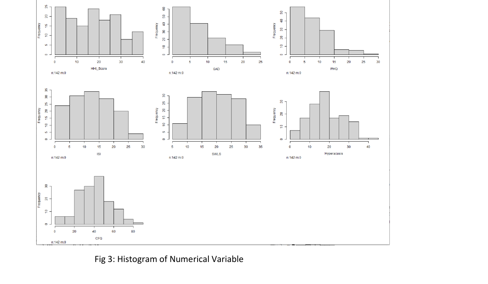
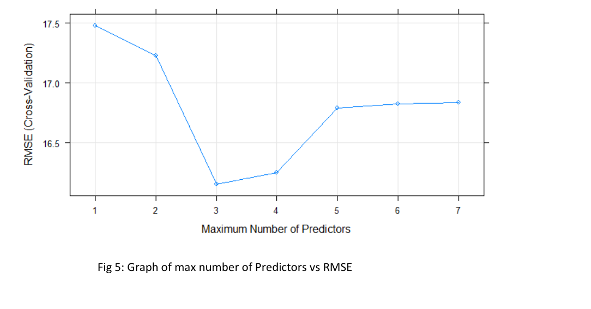
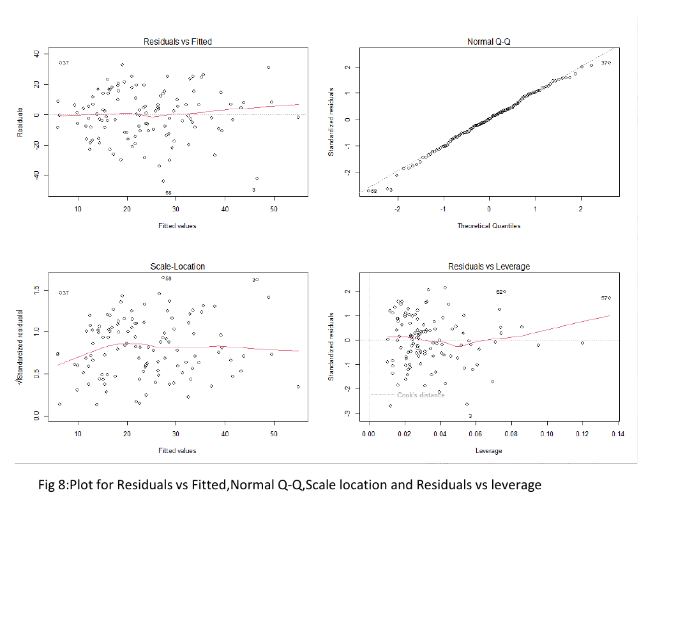

# Predicting Tinnitus Functional Index (TFI) Reduction

[](code/tinnitus_analysis.R)
[](LICENSE)

Tinnitus — a persistent ringing in the ears — is hard to treat when symptoms are severe and come with related health problems. This project asks a practical question: **which patient factors predict how much a tinnitus patient's TFI score improves after treatment?** The patients were split into a treatment group and a control group, and the goal is to predict the drop in TFI score (before minus after) from each patient's baseline measurements.

## Key Results

- **KNN regression (k = 10) wins on the test set: MSE 302.94**, versus 534.74 for the best linear model — about 43% lower error.
- **Best linear model:** `TFI_Reduction ~ PHQ + ISI + SWLS` (test MSE 534.74), with coefficients PHQ 0.772, ISI 0.726, SWLS −0.552 and intercept 19.486.
- **PHQ (depression score) is the most influential predictor** — it has the lowest p-value in the best model, so depression level is the strongest single driver of TFI reduction.
- **All three variable-selection methods agree** — backward selection, forward selection, and best-subset selection (RSS, adjusted R², Cp, BIC) all point to the same 3-variable model.
- **Data:** 115 patients, split 80/20 into 88 training and 27 test observations, with 10-fold cross-validation throughout.

## Data

The dataset (`CaseStudy1.csv`, 115 patients) is **not included in this repository** — see `data/README.md`. Variables:

| Variable | Meaning |
|---|---|
| `Group` | Control (51%) / Treatment (49%) |
| `Gender` | Male (56%) / Female (44%) |
| `HHI_Score` | Hearing Handicap Inventory score |
| `GAD` | Generalized Anxiety Disorder score |
| `PHQ` | Patient Health Questionnaire (depression) score |
| `ISI` | Insomnia Severity Index |
| `SWLS` | Satisfaction With Life Scale |
| `Hyperacusis` | Sound-sensitivity score |
| `CFQ` | Cognitive Failures Questionnaire score |
| `Pre_TFI_Score` / `Post_TFI_Score` | Tinnitus Functional Index before / after treatment |
| `TFI_Reduction` | Created for this analysis: `Pre_TFI_Score − Post_TFI_Score` (the response) |



*Figure 1 — Distributions of the quantitative variables (HHI_Score, GAD, PHQ, ISI, SWLS, Hyperacusis, CFQ).*

## Methods

1. **Descriptive analysis** — pie charts for the categorical variables (Group, Gender) and histograms for the quantitative variables.
2. **Correlation analysis** — strongest correlation is GAD–PHQ (0.76); weakest is PHQ–SWLS (−0.36).
3. **Missing values** — Post TFI scores with missing values were filled with the column mean (mean imputation), then `TFI_Reduction` was created as the response.
4. **Train/test split** — 80/20 with `set.seed(1)` and `caret::createDataPartition` (88 train / 27 test).
5. **Variable selection** — backward selection, forward selection, and best-subset selection (RSS, adjusted R², Cp, BIC), all with 10-fold cross-validation. All three methods agree on the same 3-variable model.
6. **Best linear model** — `TFI_Reduction ~ PHQ + ISI + SWLS`, with residual diagnostics and VIF checks.
7. **KNN regression** — k = 2, 4, 6, 8, 10, with 10-fold cross-validation.



*Figure 2 — Forward selection: cross-validated RMSE is lowest at 3 predictors (PHQ, ISI, SWLS), below 16.5.*

## Results (test set, n = 27)

| Model | Test MSE |
|---|---|
| Best linear model (PHQ + ISI + SWLS) | 534.7406 |
| KNN regression (k = 10) | **302.9401** |

- The 3-variable linear model: PHQ 0.772, ISI 0.726, SWLS −0.552, intercept 19.486. Backward selection's 4-variable model (adding GAD) had a slightly higher CV RMSE (~16.5).
- **PHQ is the most influential predictor** — it has the lowest p-value in the best model, so depression level is the strongest single driver of TFI reduction.
- **Tradeoff:** KNN wins on test MSE, but it cannot show each variable's separate influence the way linear regression can — so the linear model is still the one that explains *why*.



*Figure 3 — Residual diagnostics for the 3-variable linear model: residuals vs fitted, normal Q–Q, scale–location, and residuals vs leverage. No outliers beyond 3 standard deviations; the most extreme leverage points are #57, #62, and #3.*

## How to Run

1. Place `CaseStudy1.csv` in the `data/` folder (it is not committed — see `data/README.md`).
2. Install the R packages: `Hmisc`, `lessR`, `tidyverse`, `caret`, `leaps`, `car`.
3. Run the analysis from the repository root:
   ```r
   source("code/tinnitus_analysis.R")
   ```

## What's in this repo

| Path | Contents |
|---|---|
| `report/Tinnitus_TFI_Reduction_Report.pdf` | Full project report (22 pages) |
| `code/tinnitus_analysis.R` | Standalone R script, extracted from the report appendix and cleaned up to run as-is |
| `data/README.md` | Dataset description; the CSV itself is not committed |
| `images/` | Figures extracted from the report: predictor histograms, forward-selection RMSE curve, residual diagnostics |

## What is missing

- **The dataset** (`CaseStudy1.csv`) was not supplied with the report and is not committed. The analysis cannot be re-run without it.
- The script has been cleaned but not executed end-to-end in this environment (no R installed here); the reported MSEs come from the original report.

## License

MIT — see [LICENSE](LICENSE).
